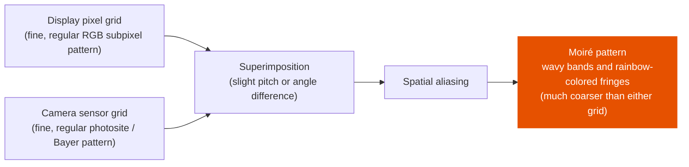
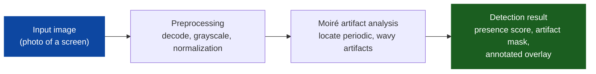

# Spatial Moiré Effect Detection

[](LICENSE)
[](https://www.python.org/)

A computer-vision project for **detecting the spatial moiré effect** — the wavy, rainbow-colored interference pattern that appears when you take a photograph of a computer screen with a digital camera.

## Table of Contents

- [What is the spatial moiré effect?](#what-is-the-spatial-moiré-effect)
- [Why detect it?](#why-detect-it)
- [How it works](#how-it-works)
- [Planned project structure](#planned-project-structure)
- [Getting started](#getting-started)
- [Usage](#usage)
- [Dataset and splits](#dataset-and-splits)
- [Documentation](#documentation)
- [Roadmap](#roadmap)
- [Contributing](#contributing)
- [License](#license)

## What is the spatial moiré effect?

When a digital camera photographs a computer screen, two fine, regular grids are effectively superimposed:

1. the **display pixel grid** — the repeating RGB subpixel pattern of the screen, and
2. the **camera sensor grid** — the photosite (Bayer) pattern of the camera.

Because the two grids almost always differ slightly in pitch or orientation, their superimposition causes *spatial aliasing*. The result is a **moiré pattern**: large, low-frequency wavy bands, stripes, or rainbow-colored fringes that appear in the photograph even though nothing of the sort is visible on the physical screen — the same effect you see when two window screens or sheer fabrics overlap.



The moiré pattern acts as a **beat pattern** between the two grids — its spatial frequency equals the small difference between the screen's and the sensor's effective sampling frequencies, which is why the artifacts are far coarser than either grid.

This project targets the *spatial* (still-image) variant of the effect. Temporal moiré — the flicker seen in videos of screens — is out of scope.

## Why detect it?

- **Image quality screening** — automatically flag photographs of screens whose quality is degraded by moiré.
- **Dataset curation** — find and filter moiré-corrupted screen photographs in large image collections.
- **Photo forensics** — moiré artifacts are physical evidence that an image is a *photo of a display* rather than a direct screenshot.
- **Preprocessing for removal** — reliable detection is the first stage of any moiré-removal or restoration pipeline.

## How it works

The project follows a simple, high-level pipeline:



The concrete detection techniques are under active development — see the [roadmap](#roadmap) for the current status.

## Planned project structure

```
Spatial-Moire-Effect-Detection/
├── src/
│   └── spatial_moire/          # Core detection package
│       ├── io/                 # Image loading & preprocessing
│       ├── analysis/           # Moiré artifact analysis
│       └── reporting/          # Visualization & result export
├── tests/                      # Unit and integration tests
├── assets/
│   └── samples/                # Sample screen-photographed images
├── docs/                       # Additional documentation
├── requirements.txt            # Project dependencies (planned)
├── LICENSE
└── README.md
```

## Getting started

**Prerequisites:** [Python 3.12](https://www.python.org/) or newer.

```bash
# 1. Clone the repository
git clone https://github.com/babak-abad/Spatial-Moire-Effect-Detection.git
cd Spatial-Moire-Effect-Detection

# 2. Create and activate a virtual environment
python -m venv .venv
.venv\Scripts\activate         # Windows
source .venv/bin/activate      # Linux / macOS

# 3. Install dependencies (torch, torchvision, imgaug, matplotlib, tqdm, ...)
pip install -r requirements.txt
```

> **Project status:** the moiré synthesis / augmentation library and the ResNet-18 baseline pipeline (training, evaluation, offline sample generation, augmentation preview) are implemented in `src/` with sanity tests in `tests/`; a packaged release is still pending. Code lands on the [`dev`](https://github.com/babak-abad/Spatial-Moire-Effect-Detection/tree/dev) branch first.

## Usage

Run the scripts from the repository root inside the activated environment. The
dataset source folders and the 0.8 / 0.1 / 0.1 train / val / test split
fractions come from `src/config.py` (see [Dataset and splits](#dataset-and-splits)).

```bash
# Train the ResNet-18 baseline (writes best_model.pt, history.json,
# split_manifest.json, training_curves.png into results/baseline_resnet18)
python src/train_baseline.py

# Evaluate the held-out test split (re-derives the exact split
# from split_manifest.json next to best_model.pt)
python src/evaluate_baseline.py

# Generate offline synthetic moiré samples from clean sources
python src/generate_moire_samples.py

# Render the HTML gallery of the training augmentation behavior
python src/preview_train_augmentation.py
```

Useful flags: `--epochs`, `--batch-size`, `--seed` (train — also fixes the
split and is recorded in the manifest), `--moire-augment-prob`,
`--group-augment` (train), `--threshold`, `--seed` (evaluate — overrides the
manifest seed), `--sampling`, `--groups` (sample generation), `--num-scenes`,
`--passes` (preview).

## Dataset and splits

The baseline consumes two **independent per-class folder pools** configured in
`src/config.py` — `CLEAN_IMAGE_FOLDERS` (65 folders, 3583 clean / gt images)
and `MOIRE_IMAGE_FOLDERS` (104 folders, 3545 real-moire images) — with no
pairing between them. `split_train_val_test` groups each class into split
units (small folders atomic, shared scene stems merged), shuffles the two unit
streams separately with `seed` / `seed + 1` and cuts each 80 / 10 / 10 into
train / val / test — 5676 / 688 / 764 samples (train 2844 clean + 2832 moire:
near 50 / 50 by construction, exactly 50 / 50 per train batch via balanced
batches). The split is recorded in `split_manifest.json` (algorithm marker
`per_class_units_v1`) next to the trained model; evaluation re-derives the
test portion from it and rejects a manifest written by a different split
algorithm. Full details: [`docs/dataset.md`](docs/dataset.md).

## Documentation

Detailed design documents live in [`docs/`](docs/):

- [`docs/dataset.md`](docs/dataset.md) — the dataset source pools and the per-class train / val / test split: the independent clean/moire folder pools, split units, the per-class seeded unit shuffles, the 0.8/0.1/0.1 fractions, the split manifest and how training / evaluation consume it.
- [`docs/augmentation.md`](docs/augmentation.md) — the label-preserving, class-aware augmentation pipeline: weighted type sampling and procedural moiré synthesis that only ever adds a pattern to moire-class fetches, plus the six seeded capture-style augmentation groups that corrupt pixels without ever moving the clean/moire label, with flow diagrams, the `apply_group_augmentation` algorithm, CLI flags, and a tuning guide.
- [`docs/moire_types.md`](docs/moire_types.md) — the canonical catalogue of the nine moiré effect types: physical causes, visual signatures, prevalence weights, and their mapping onto the synthesis generators.

## Roadmap

- [ ] Image loading and preprocessing utilities
- [ ] Moiré artifact detection engine (global presence score)
- [ ] Artifact localization (per-region masks)
- [ ] Annotated visual reports
- [ ] Command-line interface
- [ ] Sample dataset and benchmark metrics
- [ ] API documentation
- [ ] First packaged release (PyPI)

## Contributing

Contributions are welcome! Please open an issue first to discuss your idea, then submit a pull request targeting the `dev` branch.

## License

Distributed under the MIT License. See [LICENSE](LICENSE) for details.

Copyright (c) 2026 Babak Abad
