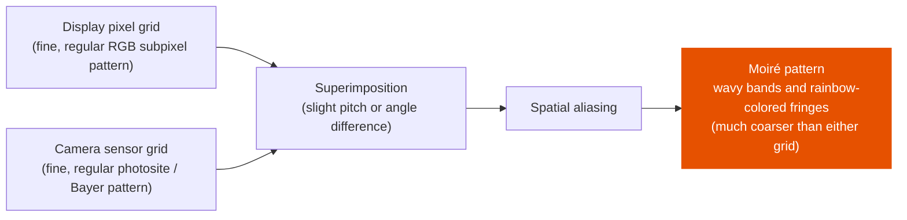
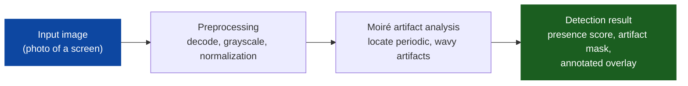

# Spatial Moiré Effect Detection

[](LICENSE)
[](https://www.python.org/)

A computer-vision project for **detecting the spatial moiré effect** — the wavy, rainbow-colored interference pattern that appears when you take a photograph of a computer screen with a digital camera.

## Table of Contents

- [What is the spatial moiré effect?](#what-is-the-spatial-moiré-effect)
- [Why detect it?](#why-detect-it)
- [How it works](#how-it-works)
- [Planned project structure](#planned-project-structure)
- [Getting started](#getting-started)
- [Usage (planned)](#usage-planned)
- [Documentation](#documentation)
- [Roadmap](#roadmap)
- [Contributing](#contributing)
- [License](#license)

## What is the spatial moiré effect?

When a digital camera photographs a computer screen, two fine, regular grids are effectively superimposed:

1. the **display pixel grid** — the repeating RGB subpixel pattern of the screen, and
2. the **camera sensor grid** — the photosite (Bayer) pattern of the camera.

Because the two grids almost always differ slightly in pitch or orientation, their superimposition causes *spatial aliasing*. The result is a **moiré pattern**: large, low-frequency wavy bands, stripes, or rainbow-colored fringes that appear in the photograph even though nothing of the sort is visible on the physical screen — the same effect you see when two window screens or sheer fabrics overlap.



The moiré pattern acts as a **beat pattern** between the two grids — its spatial frequency equals the small difference between the screen's and the sensor's effective sampling frequencies, which is why the artifacts are far coarser than either grid.

This project targets the *spatial* (still-image) variant of the effect. Temporal moiré — the flicker seen in videos of screens — is out of scope.

## Why detect it?

- **Image quality screening** — automatically flag photographs of screens whose quality is degraded by moiré.
- **Dataset curation** — find and filter moiré-corrupted screen photographs in large image collections.
- **Photo forensics** — moiré artifacts are physical evidence that an image is a *photo of a display* rather than a direct screenshot.
- **Preprocessing for removal** — reliable detection is the first stage of any moiré-removal or restoration pipeline.

## How it works

The project follows a simple, high-level pipeline:



The concrete detection techniques are under active development — see the [roadmap](#roadmap) for the current status.

## Planned project structure

```
Spatial-Moire-Effect-Detection/
├── src/
│   └── spatial_moire/          # Core detection package
│       ├── io/                 # Image loading & preprocessing
│       ├── analysis/           # Moiré artifact analysis
│       └── reporting/          # Visualization & result export
├── tests/                      # Unit and integration tests
├── assets/
│   └── samples/                # Sample screen-photographed images
├── docs/                       # Additional documentation
├── requirements.txt            # Project dependencies (planned)
├── LICENSE
└── README.md
```

## Getting started

**Prerequisites:** [Python 3.12](https://www.python.org/) or newer.

```bash
# 1. Clone the repository
git clone https://github.com/babak-abad/Spatial-Moire-Effect-Detection.git
cd Spatial-Moire-Effect-Detection

# 2. Create and activate a virtual environment
python -m venv .venv
.venv\Scripts\activate         # Windows
source .venv/bin/activate      # Linux / macOS

# 3. Install dependencies (planned — will be added with the first release)
pip install -r requirements.txt
```

> **Project status:** early stage. The repository currently ships documentation and licensing only. Package code will land on the [`dev`](https://github.com/babak-abad/Spatial-Moire-Effect-Detection/tree/dev) branch first, and the steps above become fully functional with the first release.

## Usage (planned)

The command-line interface is not implemented yet. The intended entry point:

```bash
# Planned CLI (interface may change)
python -m spatial_moire path/to/photo.jpg --output results/
```

## Documentation

Detailed design documents live in [`docs/`](docs/):

- [`docs/augmentation.md`](docs/augmentation.md) — the augmentation pipeline: how clean screen photographs become labeled moiré training samples through weighted type sampling, procedural moiré synthesis, and the six seeded capture-style augmentation groups, with flow diagrams, the `apply_group_augmentation` algorithm, CLI flags, and a tuning guide.
- [`docs/moire_types.md`](docs/moire_types.md) — the canonical catalogue of the nine moiré effect types: physical causes, visual signatures, prevalence weights, and their mapping onto the synthesis generators.

## Roadmap

- [ ] Image loading and preprocessing utilities
- [ ] Moiré artifact detection engine (global presence score)
- [ ] Artifact localization (per-region masks)
- [ ] Annotated visual reports
- [ ] Command-line interface
- [ ] Sample dataset and benchmark metrics
- [ ] API documentation
- [ ] First packaged release (PyPI)

## Contributing

Contributions are welcome! Please open an issue first to discuss your idea, then submit a pull request targeting the `dev` branch.

## License

Distributed under the MIT License. See [LICENSE](LICENSE) for details.

Copyright (c) 2026 Babak Abad
