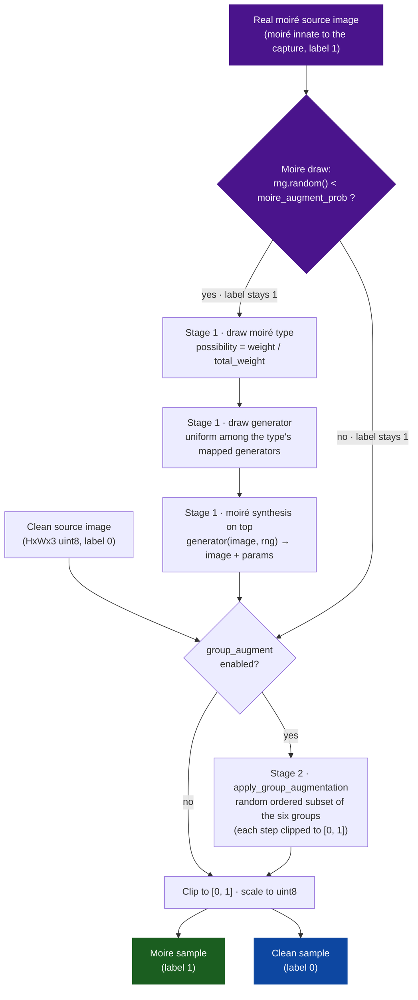
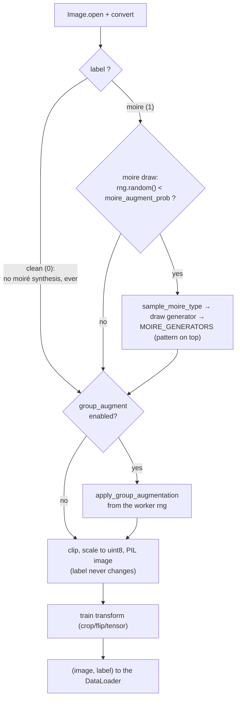

# Augmentation pipeline — moiré synthesis plus capture-style group corruption

This document is the canonical description of how augmented data is produced:
a two-stage, **label-preserving, class-aware** pipeline shared by both
classes. **Stage 1** synthesizes one additional moiré pattern (procedural
generators driven by the weighted type registry of `docs/moire_types.md`) —
reachable only from the moire-class path: with probability `moire_augment_prob`
a real moiré photograph gains a pattern on top of the moiré innate to the
capture. **Stage 2** optionally corrupts every fetch — patterned or plain
moire, and clean images alike — with a random subset of capture-style
augmentation groups (imgaug) that emulate sensor read noise, exposure error,
tone-curve drift, defocus/shake blur, dead pixels and camera-angle drift — so
moiré evidence is degraded the way a fresh capture would degrade it while the
clean class sees the very same corruption, never letting degradation itself
become a moiré cue. Labels never change on any path: a clean image can never
become moiré inside the training pipeline (offline synthesis in
`src/generate_moire_samples.py` is the only place a clean source turns into
new moiré-class files).

Machine-readable counterparts:

| Concern | Module |
|---|---|
| Weighted moiré type registry | `src/spatial_moire/moire_types.py` (`MOIRE_TYPES`) |
| Moiré pattern generators | `src/spatial_moire/synthesis/augment.py` (`MOIRE_GENERATORS`) |
| Augmentation group registry + algorithm | `src/spatial_moire/synthesis/groups.py` (`AUGMENTATION_GROUPS`, `apply_group_augmentation`) |
| Every hard-coded range | `src/config.py` (`GROUP_*`, per-generator `*_RANGE`) |
| On-the-fly training dataset | `src/spatial_moire/baseline/augmentation.py` (`augmented_moire_dataset`) |
| Balanced train batches | `src/spatial_moire/baseline/data.py` (`balanced_moire_dataset`, `balanced_shuffle_sampler`), `src/config.py` (`TRAIN_BALANCED_BATCHES`) |
| Offline sample generation | `src/generate_moire_samples.py` |
| Dataset source pools & split fractions | `src/config.py` (`CLEAN_IMAGE_FOLDERS`, `MOIRE_IMAGE_FOLDERS`, `TRAIN_FRACTION` / `VAL_FRACTION` / `TEST_FRACTION`) — see `docs/dataset.md` |

## Pipeline overview



The label of a fetch always equals the label of its source sample. Clean
images (label 0) never enter Stage 1 — moiré synthesis is structurally
unreachable on the clean path, so `moire_augment_prob` has no effect on them:
with group augmentation off they reach the output pixel-identical to the
source file, with it on they receive the same capture-style corruption as the
positives while staying clean, so degradation itself can never act as a moiré
cue. Real moiré images (label 1) may gain, with probability
`moire_augment_prob`, one additional synthesized moiré pattern on top of the
moiré innate to the capture, then flow into the same `group_augment enabled?`
decision. When group augmentation is disabled (or draws zero groups) the
clip/scale round-trip is lossless, so an unaugmented fetch is pixel-identical
to the source file with its original label. Either way every sample undergoes
only the standard train transform (crop/flip/tensor). Source files are never
modified on any path.

## Stage 1 — moiré synthesis

1. **Type draw** — `sample_moire_type(rng=...)` draws one of the nine registry
   types with possibility `weight / total_weight` (see
   `docs/moire_types.md` for the taxonomy, weights and per-type causes).
2. **Generator draw** — the type maps to one or two generator names
   (`generator_names_for_type`); one is drawn uniformly.
3. **Synthesis** — the generator returns `(image, params)`. Most generators
   blend a procedural pattern via
   `image * (1 + strength * (2 * pattern - 1))`, clipped to `[0, 1]`;
   `screen_shoot` mixes a display-grid/camera-grid simulation by `strength`;
   `nested_moire` applies two other generators in sequence. All random
   parameters come from the caller's numpy `Generator`.

## Stage 2 — group augmentation algorithm

`apply_group_augmentation(image=..., rng=..., group_subset=...,
num_groups_range=...)` in `src/spatial_moire/synthesis/groups.py`:

```text
validate image shape HxWx3 and dtype float32      → ValueError otherwise
                                                   (values in [0, 1] are the caller's contract)
(low, high) = validated num_groups_range           (default (2, 4))
selected    = validated group names                (all six by default)

num_groups = min(rng.integers(low, high + 1), len(selected))
chosen     = rng.choice(selected, size=num_groups, replace=False)   # random order

result = image
for group_name in chosen:                          # apply in drawn order
    factory = factories[rng.integers(0, len(factories))]  # one augmenter per group
    seed    = rng.integers(0, 2**31)                      # child augmenter seed
    result  = factory(seed).augment_image(result)
    result  = clip(result, 0, 1).astype(float32)          # clip after EVERY step

return result, {count_range: (low, high), num_groups,
                groups: [{group, augmenter, seed}, ...]}
```

Key properties:

- **One augmenter per group** — a group holds several alternative imgaug
  factories; exactly one is drawn per applied group.
- **Subset without replacement, random order** — a group appears at most once
  per image and the application order varies across draws.
- **Per-step clipping** — imgaug targets uint8 while this pipeline works on
  float32 `[0, 1]`; some augmenters (Multiply, additive noise, blur edges)
  overflow the range, so each step is clipped back before the next.
- **Determinism** — the subset size, the subset itself, the order, the factory
  pick and every child seed are all drawn from the *caller's* `rng`, so an
  identical seed reproduces a bit-identical image *and* recipe; the recipe is
  JSON-friendly and is recorded in synthesis manifests.

## Group registry

| Group | Physical motivation | imgaug augmenters (one drawn) | Key ranges (config) |
|---|---|---|---|
| `noise` | sensor read noise | `AdditiveGaussianNoise` (×2, one per-channel), `AdditiveLaplaceNoise` | σ 0.01–0.05, scale 0.01–0.04 |
| `photometric` | exposure / gain error | `Multiply` (×2, one per-channel 50%), `AddElementwise` | mul 0.7–1.3, add ±0.08 |
| `contrast` | tone-curve drift | `GammaContrast`, `LinearContrast`, `SigmoidContrast` | γ 0.7–1.4, α 0.75–1.3, gain 3–10 / cutoff 0.4–0.6 |
| `blur` | defocus / camera shake | `GaussianBlur`, `AverageBlur`, `MotionBlur` | σ 0–1.2, k 3–5, k=7 / angle ±45° |
| `dropouts` | dead pixels / lost packets | `CoarseDropout`, `Dropout` (per-channel 50%) | p 0–0.05 / size 0.1–0.3, p 0–0.02 |
| `geometric` | camera-angle drift | `Affine` (scale+rotate), `Affine` (shear+translate); bilinear, constant fill 0.5, skimage backend | scale 0.92–1.08, rotate ±8°, shear ±6°, translate 0–4% |

Default applied count per image: `GROUP_AUGMENT_COUNT_RANGE = (2, 4)`.

## The two consumers

### On-the-fly training augmentation

`augmented_moire_dataset` (in `src/spatial_moire/baseline/augmentation.py`),
used by `src/train_baseline.py`. Its samples come from the config-driven
per-class split (see `docs/dataset.md`): training feeds it the train portion
of `split_train_val_test` and validates on the val portion:



- Each DataLoader worker owns its own `Generator` seeded `seed + worker_id`,
  so augmentation is reproducible and workers never share state.
- Constructor options: `moire_augment_prob` (default from
  `MOIRE_AUGMENT_PROB`), `type_names` (subset, all by default),
  `group_augment` (off by default), `group_names` (subset, all by default),
  `num_groups_range` (default `(2, 4)`) and `balanced` (off by default) —
  invalid probabilities, type names, group names or ranges raise `ValueError`
  at construction time.
- `moire_augment_prob` (`--moire-augment-prob`) is the probability that a
  **moire-class fetch** gains one additional synthesized moiré pattern,
  drawn by weighted type sampling and rendered before the groups. Clean
  fetches are unaffected by it — pixel-identical when group augmentation is
  off, group-corrupted but still label 0 when on — so the flag can never move
  the clean/moire class boundary; the label mix stays that of the split (or
  exactly half/half per batch with balanced batches).
- Real moiré fetches at `moire_augment_prob = 0` pass through unchanged
  (pixel-identical when groups are off); at `moire_augment_prob = 1` every
  moire fetch gains a pattern on top of the innate moiré — pinned by
  `check_zero_probability_keeps_labels_and_pixels`,
  `check_patterned_moire_images_keep_label` and `check_same_seed_is_reproducible`
  in `tests/test_augmentation.py`.
- Clean fetches keep label 0 and are pixel-identical unless group
  augmentation is enabled, in which case they receive the capture-style
  groups while staying clean — pinned by
  `check_clean_images_never_become_moire` and
  `check_clean_images_keep_label_under_group_augmentation`. The moiré draw
  is unreachable on the clean path, so it is skipped without consuming rng.

#### Balanced train batches (default)

`TRAIN_BALANCED_BATCHES = True` makes `src/train_baseline.py` serve exactly
balanced train batches: every batch of an even `batch_size` holds
`batch_size // 2` clean and `batch_size // 2` moire items. The mechanism is the
interleaved virtual index space of `balanced_moire_dataset` — even indices
address the clean pool, odd indices the moire pool, both cycling modulo their
pool size — combined with `balanced_shuffle_sampler`, which shuffles the slot
order (seeded, reshuffled every epoch) while keeping each (clean, moire) pair
adjacent, so no contiguous window of the stream can drift off balance. The
smaller class pool is oversampled to `max(n_clean, n_moire)` slots per class
per epoch; an odd `batch_size` (or below 2) is rejected up front, and
`--no-balance-batches` restores plain shuffled batches.

Inside `augmented_moire_dataset(balanced=True)` the parity fixes the class:
even slots are clean fetches that only ever receive the label-neutral group
augmentation, odd slots are moire fetches drawn from the **real moire pool** —
passed through at `moire_augment_prob = 0` or, with probability
`moire_augment_prob`, granted one additional synthesized pattern on top of the
innate moiré, so `moire_augment_prob` is the patterned share of the moire
half. There is no synthesis fallback: an empty clean or moire pool raises
`ValueError` (balance requires real images of both classes).

### Offline sample generation

`src/generate_moire_samples.py` writes JPEG samples, previews and
`moire_synthesis_params.json`. It only ever consumes **clean** source
images — its job is manufacturing synthetic positives, so real moiré
images never flow through it:

- `--sampling grid` renders one sample per selected type per source image
  (full preview grid); `--sampling weighted` draws each sample's type by
  `weight / total_weight`.
- Both modes route through `render_moire_type`, which runs the mapped
  generator and then, with `--groups`, the group augmentation, merging the
  recipe into the entry's `params["groups"]`.
- The manifest's top-level `group_augmentation` block records
  `{group_names, count_range}` (or `null` when off) alongside `seed`,
  `sampling`, `type_probabilities` and per-entry `type` / `generator` /
  `variant` / `probability` / `params`.

## CLI flags

| Script | Flag | Effect |
|---|---|---|
| `src/generate_moire_samples.py` | `--groups` | corrupt every sample with the group pipeline |
| | `--group-names NAME ...` | restrict the draw to a subset of groups (all by default) |
| | `--group-count LOW HIGH` | inclusive applied-groups range (default `(2, 4)`) |
| `src/train_baseline.py` | `--moire-augment-prob P` | probability a moire-class fetch gains one extra synthesized pattern (default from `MOIRE_AUGMENT_PROB`) |
| | `--group-augment` | corrupt every training image with the groups, labels unchanged |
| | `--augment-groups NAME ...` | restrict the group subset (all by default) |
| | `--augment-group-count LOW HIGH` | inclusive applied-groups range (default `(2, 4)`) |
| | `--no-balance-batches` | fall back from exactly half/half train batches (default) to plain shuffled batches |

Group augmentation composes with the existing moiré flags
(`--moire-augment-prob`, `--moire-augment-types`, `--types`, `--sampling`,
`--variants`, `--seed`) and with the balanced-batch default
(`--no-balance-batches` opts out).

## Validation guarantees

`tests/test_groups.py` and `tests/test_augmentation.py` pin the contract:

- every factory builds a named augmenter; every group preserves shape, float32
  dtype and finiteness on `[0, 1]` input;
- pipeline output stays HxWx3 float32 in `[0, 1]`; fixed counts apply exactly
  that many unique groups; requested subsets are honored; order varies;
- a `(0, 0)` count is an exact identity;
- identical seeds reproduce images and recipes, different seeds differ;
- invalid images, count ranges and group names raise `ValueError`;
- groups compose after moiré synthesis, and the label contract is total —
  clean fetches stay label 0, real moiré fetches stay label 1 with or without
  an extra pattern, and equal seeds reproduce bit-identically (pinned by
  `check_clean_images_never_become_moire`,
  `check_real_moire_images_follow_group_augment_flag` and
  `check_same_seed_is_reproducible` in `tests/test_augmentation.py`; the full
  on-the-fly guarantees are listed above);
- group-augmented images flow through the train transform as
  `(3, crop, crop)` tensors.

`tests/test_balanced_batches.py` pins the balanced-batch contract: parity
labels and the `2 * max(pool)` length, exact half/half batches through a real
DataLoader (also with workers and unbalanced sources), `moire_augment_prob`
semantics per parity (clean slots never synthesized, moire slots real
sources), sampler adjacency / reproducibility / per-epoch reshuffle,
`ValueError` on empty pools, and unchanged legacy behavior when
`balanced=False`.

## Tuning

1. Edit the `GROUP_*` values in `src/config.py` (ranges are inclusive
   `(low, high)` tuples consumed by the imgaug factories).
2. Change the per-image count via `GROUP_AUGMENT_COUNT_RANGE` or the CLI
   `--group-count` / `--augment-group-count` overrides.
3. Add a group by appending a name → tuple-of-factories entry to
   `AUGMENTATION_GROUPS` (plus new config ranges); unknown names and empty
   selections are rejected, and `tests/test_groups.py` expects the registry to
   stay populated (≥ 5 groups, ≥ 1 factory each).

## Scope and compatibility notes

- **imgaug 0.4.0 predates numpy 2.x**: `groups.py` patches the removed
  `np.sctypes` / `np.bool` / `np.complex` aliases *before* importing imgaug
  (imgaug reads them at import time). The patch is guarded by `hasattr` so it
  stays inert on future imgaug releases.
- **Salt / Pepper augmenters are excluded** on purpose: they write raw 0–255
  values on float arrays, so pepper would turn into white specks after the
  `[0, 1]` clipping. `CoarseDropout` / `Dropout` cover the dead-pixel look.
- **Groups run after moiré synthesis whenever synthesis happens, never
  before**: the moiré pattern — innate or synthesized — must be degraded the
  way real capture degrades it, not bypassed. Clean inputs skip synthesis
  entirely but still pass through the group decision afterwards, with their
  labels unchanged.
- Group augmentation never writes to source files; only in-memory copies
  (training) or new output files (sample generation) are affected. Offline
  sample generation still consumes clean sources only — the real-moiré
  passthrough and clean-fetch branches of the flow above exist in the
  training dataset alone.