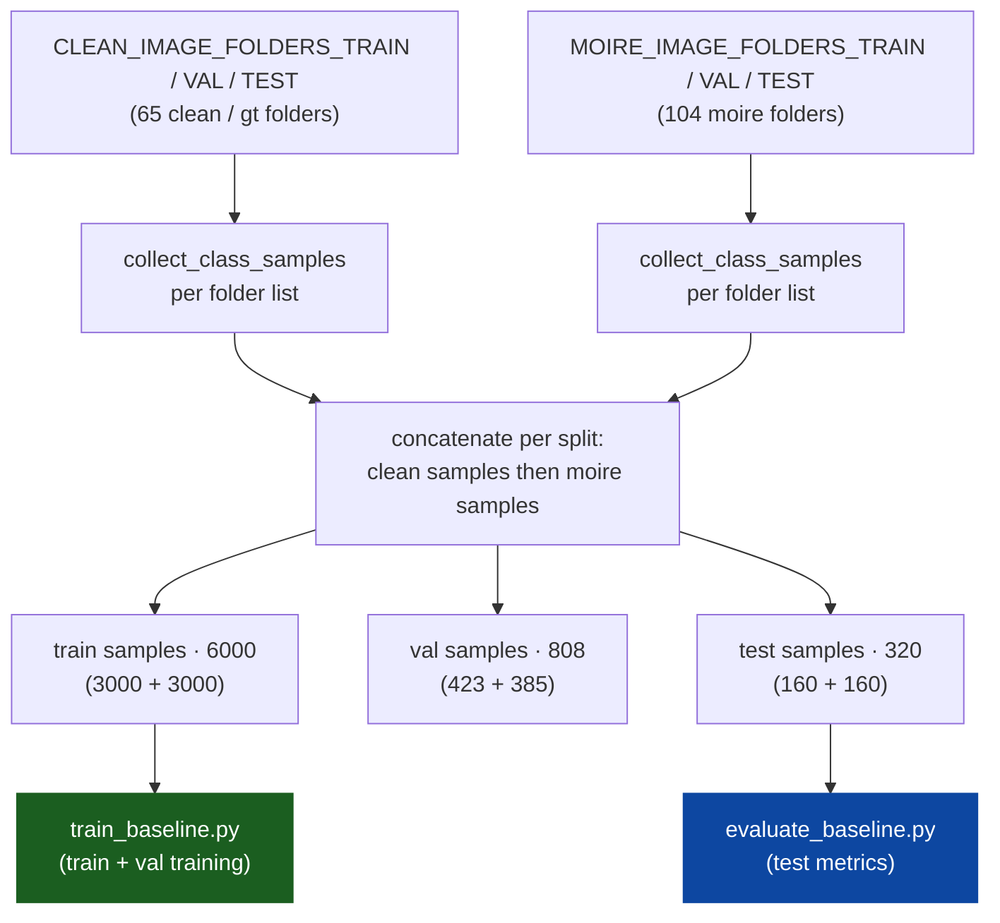

# Dataset sources and the train / val / test split

This document is the canonical description of where the baseline's images come
from and how every image is assigned to the train, validation or test split.
The baseline consumes two **independent per-class folder pools** — one
moire-free (clean / gt), one real-moire — and assigns each source folder to
exactly one split via six explicit folder lists. There is no pairing between
the pools: the two class lists may differ in length and content, and a
sample's label comes from its pool alone.

Machine-readable counterparts:

| Concern | Module |
|---|---|
| Clean / moire source folder lists | `src/config.py` (`CLEAN_IMAGE_FOLDERS_{TRAIN,VAL,TEST}`, `MOIRE_IMAGE_FOLDERS_{TRAIN,VAL,TEST}`) |
| Combined pools (ordered unions of the six lists) | `src/config.py` (`CLEAN_IMAGE_FOLDERS`, `MOIRE_IMAGE_FOLDERS`) |
| Split engine | `src/spatial_moire/baseline/data.py` (`collect_class_samples`, `split_datasets`) |

## Source pools and folder lists

Six flat, independent folder lists, defined in `src/config.py`. The lists
declare the split directly — the split **is** the folder assignment:

- `CLEAN_IMAGE_FOLDERS_TRAIN` — the `gt` half of the local LCDMoire `train/`
  subset (1 folder, 3000 images).
- `CLEAN_IMAGE_FOLDERS_VAL` — 63 folders of moire-free phone photographs
  (423 images).
- `CLEAN_IMAGE_FOLDERS_TEST` — the `gt` half of the LCDMoire `test/` subset
  (1 folder, 160 images).
- `MOIRE_IMAGE_FOLDERS_TRAIN` — the `moire` half of the LCDMoire `train/`
  subset (1 folder, 3000 images).
- `MOIRE_IMAGE_FOLDERS_VAL` — 102 folders of moire-affected phone
  photographs (385 images).
- `MOIRE_IMAGE_FOLDERS_TEST` — the `moire` half of the LCDMoire `test/`
  subset (1 folder, 160 images).

The combined pools `CLEAN_IMAGE_FOLDERS` (65 folders, 3583 images) and
`MOIRE_IMAGE_FOLDERS` (104 folders, 3545 images) exist for consumers that
address a class's folders positionally; each pool is the ordered union of its
class's train + val + test lists.

The class lists are deliberately **not** index-aligned and share no filename
contract — either class's lists can grow or shrink independently. Folders are
scanned non-recursively for `IMAGE_EXTENSIONS` files. `collect_class_samples`
walks one folder list and emits `{"path", "label"}` dicts in (folder,
filename) order; it raises `ValueError` for a missing folder or one that holds
no supported image. The label comes from the list alone — never from image
content or augmentation.

`src/generate_moire_samples.py` consumes clean images only and defaults to
`CLEAN_IMAGE_FOLDERS_TRAIN[0]` (`DEFAULT_SOURCE_DIR`).

## Split semantics

`split_datasets` in `src/spatial_moire/baseline/data.py`:

```text
resolve the six folder lists (explicit args, else the config defaults)
validate per class: every list non-empty; the train / val / test lists of
    one class pairwise disjoint                       → ValueError otherwise
train = collect_class_samples(CLEAN_..._TRAIN, 0) + collect_class_samples(MOIRE_..._TRAIN, 1)
val   = collect_class_samples(CLEAN_..._VAL,   0) + collect_class_samples(MOIRE_..._VAL,   1)
test  = collect_class_samples(CLEAN_..._TEST,  0) + collect_class_samples(MOIRE_..._TEST,  1)
each split's sample list = its clean samples followed by its moire samples
```

With the default lists that yields **6000 / 808 / 320 samples** — train 3000
clean + 3000 moire (exactly 50 / 50 by construction, and 50 / 50 in every
train batch via balanced batches), val 423 clean + 385 moire, test 160 clean
+ 160 moire.

Key properties:

- **Per-class independence** — the two classes are collected and assigned
  separately; nothing couples them.
- **Determinism** — no shuffle, no seed, no sampling: the split is fully
  determined by the six lists, so repeated calls reproduce it exactly and
  training and evaluation always agree.
- **Exact coverage** — every folder (and therefore every pooled image) belongs
  to exactly one split per class, without duplicates.




## Consumers

| Script | Reads | Notes |
|---|---|---|
| `src/train_baseline.py` | the six config lists via `split_datasets()` | trains on train, validates on val, holds out test |
| `src/evaluate_baseline.py` | the six config lists via `split_datasets()` | evaluates on the same deterministic test split — no manifest, no seed |
| `src/preview_train_augmentation.py` | the two `*_IMAGE_FOLDERS_TRAIN` lists | per-class seeded scene picks for the augmentation gallery |
| `src/generate_moire_samples.py` | `CLEAN_IMAGE_FOLDERS_TRAIN[0]` | offline synthesis consumes clean images only |
| `tests/test_data_split.py` | all of the above | pins the guarantees below |

## Tuning

- **Add a source folder** — append one path to the `*_IMAGE_FOLDERS_{TRAIN,
  VAL, TEST}` list of its class; the class lists are independent, so no
  matching entry is required. A missing or empty folder fails loudly with
  `ValueError`.
- **Move data between splits** — move the folder entry from one list to
  another (e.g. from val to test). The change takes effect for every consumer
  on the next run; retrain so the checkpoint and the evaluated split stay
  aligned.
- **Reproducibility** — the split needs no seed; `--seed` on
  `src/train_baseline.py` only fixes the augmentation and DataLoader draws.

## Validation guarantees

`tests/test_data_split.py` pins the contract:

- the combined pools are the ordered unions of the six lists, and no folder is
  listed twice within one class;
- each class's train / val / test lists are non-empty and pairwise disjoint,
  so a source folder never feeds two splits of one class;
- each split's sample list equals its two folder lists' samples in (folder,
  filename) order, with the clean samples followed by the moire samples;
- the three splits cover every pooled sample exactly once, without
  duplicates, and labels always follow the folder lists;
- repeated `split_datasets()` calls reproduce the splits exactly;
- empty lists, a folder listed in two splits of one class, missing folders
  and folders without supported images raise `ValueError`.