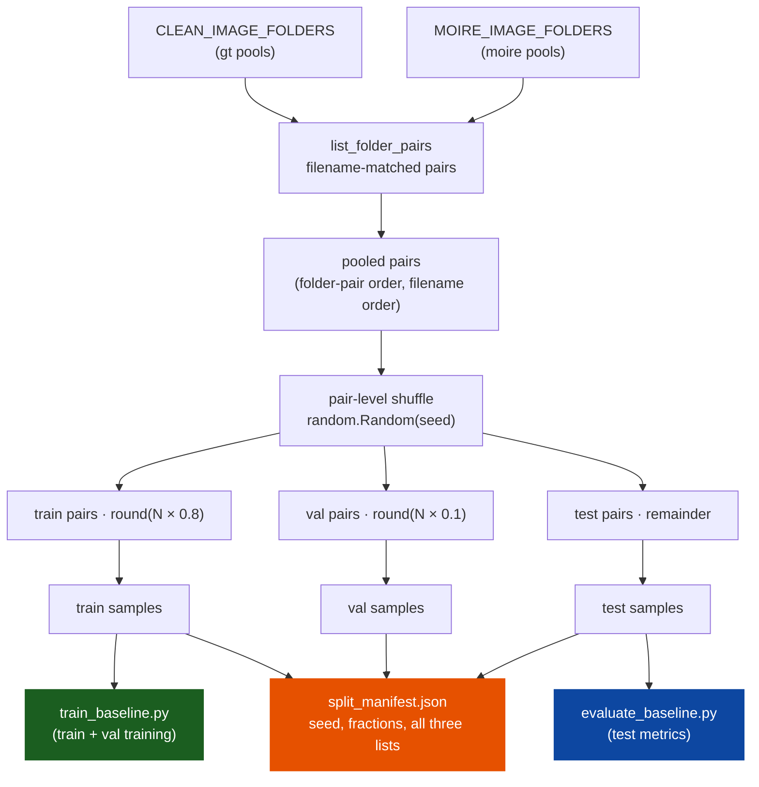

# Dataset sources and the train / val / test split

This document is the canonical description of where the baseline's images come
from and how every scene is assigned to the train, validation or test split.
The physical `train/` and `test/` folders of the local LCDMoire subset are two
entries of a pooled source list — the split itself is re-derived from
percentages over the pooled scene pairs, not taken from the folder names.

Machine-readable counterparts:

| Concern | Module |
|---|---|
| Clean / moire source folder pools | `src/config.py` (`CLEAN_IMAGE_FOLDERS`, `MOIRE_IMAGE_FOLDERS`) |
| Split fractions | `src/config.py` (`TRAIN_FRACTION`, `VAL_FRACTION`, `TEST_FRACTION`) |
| Split engine | `src/spatial_moire/baseline/data.py` (`list_folder_pairs`, `split_train_val_test`) |
| Split manifest | `src/spatial_moire/baseline/data.py` (`save_split_manifest`, `load_split_manifest`) and `src/config.py` (`SPLIT_MANIFEST_FILENAME`) |

## Source pools

Two index-aligned folder lists, defined in `src/config.py`:

```text
CLEAN_IMAGE_FOLDERS = [datasets/LCDMoire/my_dataset_final/train/gt,   datasets/LCDMoire/my_dataset_final/test/gt]
MOIRE_IMAGE_FOLDERS = [datasets/LCDMoire/my_dataset_final/train/moire, datasets/LCDMoire/my_dataset_final/test/moire]
```

`CLEAN_IMAGE_FOLDERS[i]` and `MOIRE_IMAGE_FOLDERS[i]` contain the **same
scenes matched by filename** (the LCDMoire gt / moire twins: for every scene
there is exactly one clean `gt/x.jpg` and one real-moire `moire/x.jpg`). A
scene pair is therefore the indivisible split unit — the twins can never be
separated across train / val / test, which would otherwise leak
near-duplicate images between the splits.

Folders are scanned non-recursively for `IMAGE_EXTENSIONS` files.
`list_folder_pairs` raises `ValueError` when the two lists differ in length, a
folder is missing or empty, or the moire / clean filenames do not match.

`src/generate_moire_samples.py` consumes clean images only and defaults to
`CLEAN_IMAGE_FOLDERS[0]` (`DEFAULT_SOURCE_DIR`).

## Split algorithm

`split_train_val_test` in `src/spatial_moire/baseline/data.py`:

```text
validate fractions (each in [0, 1], sum == 1.0)        → ValueError otherwise
groups = list_folder_pairs(clean, moire)               # one list per folder pair
pairs  = concat(groups) in folder-pair then filename order
random.Random(seed).shuffle(pairs)                     # pair-level shuffle only

train_count = round(len(pairs) * TRAIN_FRACTION)
val_count   = round(len(pairs) * VAL_FRACTION)

train = samples_from_pairs(pairs[:train_count])        # each pair → moire (1), clean (0)
val   = samples_from_pairs(pairs[train_count : train_count + val_count])
test  = samples_from_pairs(pairs[train_count + val_count :])    # the remainder
```

With the default pools (3000 + 160 = 3160 scene pairs) and the default
fractions 0.8 / 0.1 / 0.1 that yields **5056 / 632 / 632 samples**.

Key properties:

- **Pair-level split** — both twins of a scene always land in the same split.
- **Exact coverage** — train and val pair counts are `round(total × fraction)`,
  test receives the remainder, so every pooled pair is in exactly one split.
- **Class balance** — every pair contributes one moire and one clean sample,
  so each split is exactly 50 / 50.
- **Determinism** — the shuffle is `random.Random(seed)`; the same seed always
  reproduces the same split.



## The split manifest

`src/train_baseline.py` writes `split_manifest.json` next to `best_model.pt`
(`SPLIT_MANIFEST_FILENAME` in `src/config.py`) with the seed, the three
fractions, the sample counts and the full train / val / test sample lists.

`src/evaluate_baseline.py` re-derives the test split from the settings
recorded in that manifest, so it always evaluates on the exact scenes
training held out — even when `src/config.py` fractions have changed since.
Resolution order for the seed and fractions:

1. an explicit `--seed` flag,
2. the seed and fractions recorded in `split_manifest.json`,
3. the current `src/config.py` values (`DEFAULT_SEED` and the fraction
   defaults) when no manifest exists.

## Consumers

| Script | Reads | Notes |
|---|---|---|
| `src/train_baseline.py` | folder pools + fractions + `--seed` | trains on train, validates on val, holds out test; writes `split_manifest.json` |
| `src/evaluate_baseline.py` | manifest seed / fractions (or config defaults) | evaluates on the re-derived test split |
| `src/preview_train_augmentation.py` | first folder pair only | scene stems repeat across folder pairs and the gallery keys images by (kind, stem) |
| `src/generate_moire_samples.py` | `CLEAN_IMAGE_FOLDERS[0]` | offline synthesis consumes clean images only |
| `tests/test_data_split.py` | all of the above | pins the guarantees below |

## Tuning

- **Add a source folder pair** — append one path to `CLEAN_IMAGE_FOLDERS` and
  the matching path to `MOIRE_IMAGE_FOLDERS` (same index, same filenames); a
  stray or mismatched folder fails loudly with `ValueError`.
- **Change the split ratios** — edit `TRAIN_FRACTION` / `VAL_FRACTION` /
  `TEST_FRACTION` (they must sum to 1.0) and retrain; the manifest then
  records the new fractions for evaluation.
- **Change the draw** — pass `--seed` to `src/train_baseline.py`; the seed is
  recorded in the manifest so evaluation stays aligned.

## Validation guarantees

`tests/test_data_split.py` pins the contract:

- the config folder lists are index-aligned, existing and filename-matched;
- split sizes follow `round(total × fraction)` with test as the remainder,
  and every split is class-balanced;
- no moire / clean twin pair is ever separated across two splits;
- the three splits cover every pooled sample exactly once, without duplicates;
- identical seeds reproduce the split and different seeds change it;
- invalid fractions and malformed folder pools raise `ValueError`;
- `split_manifest.json` round-trips the seed, the fractions and all three
  sample lists, and the split is re-derivable from the recorded settings.