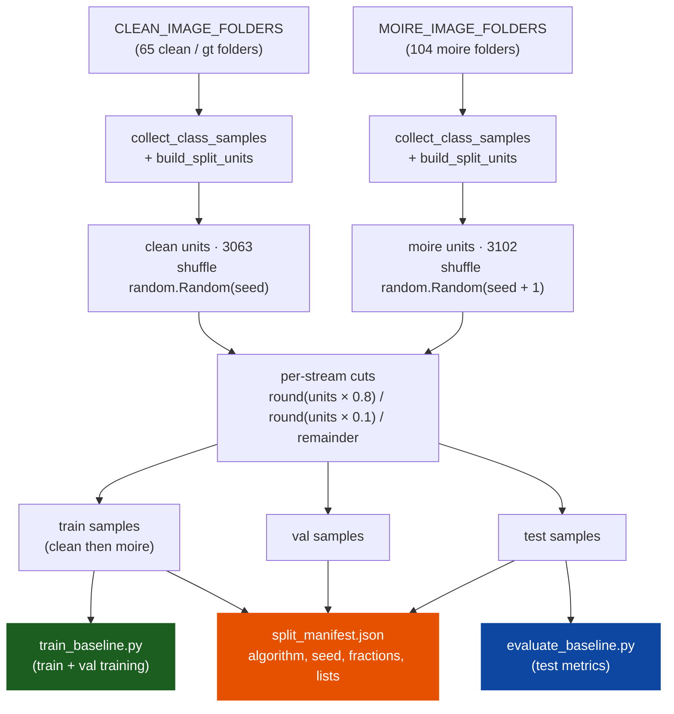

# Dataset sources and the train / val / test split

This document is the canonical description of where the baseline's images come
from and how every image is assigned to the train, validation or test split.
The baseline consumes two **independent per-class folder pools** — one
moire-free (clean / gt), one real-moire — and derives the split **per class**
from percentages over per-class split units. There is no pairing between the
pools: the two lists may differ in length and content, and a sample's label
comes from its pool alone (`docs/separated_pipelines_plan.html` records the
design rationale).

Machine-readable counterparts:

| Concern | Module |
|---|---|
| Clean / moire source folder pools | `src/config.py` (`CLEAN_IMAGE_FOLDERS`, `MOIRE_IMAGE_FOLDERS`) |
| Split fractions | `src/config.py` (`TRAIN_FRACTION`, `VAL_FRACTION`, `TEST_FRACTION`) |
| Unit-grouping threshold | `src/config.py` (`FOLDER_UNIT_MAX_IMAGES`) |
| Split engine | `src/spatial_moire/baseline/data.py` (`collect_class_samples`, `build_split_units`, `split_train_val_test`) |
| Split manifest | `src/spatial_moire/baseline/data.py` (`save_split_manifest`, `load_split_manifest`, `SPLIT_MANIFEST_ALGORITHM`) and `src/config.py` (`SPLIT_MANIFEST_FILENAME`) |

## Source pools

Two flat, independent folder lists, defined in `src/config.py`:

- `CLEAN_IMAGE_FOLDERS` — 65 folders holding 3583 moire-free images: the
  pooled `gt` (ground-truth) halves of the local LCDMoire subset
  (`train/` and `test/`) plus 63 folders of moire-free phone photographs.
- `MOIRE_IMAGE_FOLDERS` — 104 folders holding 3545 real-moire images: the
  pooled `moire` halves of the LCDMoire subset plus 102 folders of
  moire-affected phone photographs.

The lists are deliberately **not** index-aligned and share no filename
contract — either list can grow or shrink independently. Folders are scanned
non-recursively for `IMAGE_EXTENSIONS` files. `collect_class_samples` walks
one pool and emits `{"path", "label"}` dicts in (folder, filename) order; it
raises `ValueError` for a missing folder or one that holds no supported
image. The label comes from the pool alone — never from image content or
augmentation.

`src/generate_moire_samples.py` consumes clean images only and defaults to
`CLEAN_IMAGE_FOLDERS[0]` (`DEFAULT_SOURCE_DIR`).

## Split units

Before splitting, each class stream is grouped into **split units** — the
indivisible blocks the split never cuts in half (`build_split_units`):

- a folder holding at most `FOLDER_UNIT_MAX_IMAGES` (default 32) images is one
  atomic unit, so burst-grouped captures of one scene stay together;
- a larger folder contributes one unit per image, and images sharing a
  filename stem across the larger folders of one stream merge into a single
  unit, so repeated scene stems cannot straddle splits.

Units keep pool order (folder order, then filename order); with the default
pools this yields 3063 clean units and 3102 moire units. Unit grouping never
crosses classes: a gt / moire twin pair of the same LCDMoire scene may land in
different splits — class balance is enforced at batch level by the balanced
batches of `docs/augmentation.md`, not by the split.

## Split algorithm

`split_train_val_test` in `src/spatial_moire/baseline/data.py`:

```text
validate fractions (each in [0, 1], sum == 1.0)         → ValueError otherwise
clean_units = build_split_units(CLEAN_IMAGE_FOLDERS, 0)
moire_units = build_split_units(MOIRE_IMAGE_FOLDERS, 1)
random.Random(seed).shuffle(clean_units)                 # per-class shuffles
random.Random(seed + 1).shuffle(moire_units)

per stream, independently:
    train_count = round(len(units) * TRAIN_FRACTION)     # unit-level cuts
    val_count   = round(len(units) * VAL_FRACTION)
    train      ← units[:train_count]
    val        ← units[train_count : train_count + val_count]
    test       ← units[train_count + val_count :]        # the remainder
each split's sample list = its clean samples followed by its moire samples
```

With the default pools (3063 clean / 3102 moire units) and the default
fractions 0.8 / 0.1 / 0.1 that yields **5676 / 688 / 764 samples** — train
2844 clean + 2832 moire, val 337 + 351, test 402 + 362: near 50 / 50 by
construction, and exactly 50 / 50 in every train batch via balanced batches.

Key properties:

- **Per-class independence** — the two streams are collected, grouped,
  shuffled and cut separately; nothing couples them.
- **Unit-level atomicity** — a small folder's burst and a shared scene stem
  within one stream always land in the same split.
- **Exact coverage per class** — train and val unit counts are
  `round(units × fraction)` and test receives the remainder, so every pooled
  image is in exactly one split, without duplicates.
- **Determinism** — two seeded shuffles (`seed`, `seed + 1`); the same seed
  always reproduces the same split.



## The split manifest

`src/train_baseline.py` writes `split_manifest.json` next to `best_model.pt`
(`SPLIT_MANIFEST_FILENAME` in `src/config.py`) with the split algorithm
marker (`SPLIT_MANIFEST_ALGORITHM = "per_class_units_v1"`), the seed, the
three fractions, the `FOLDER_UNIT_MAX_IMAGES` threshold the units were built
with, the sample counts and the full train / val / test sample lists.

`src/evaluate_baseline.py` re-derives the test split from the settings
recorded in that manifest, so it always evaluates on the exact images
training held out — even when `src/config.py` fractions have changed since.
A manifest written by a different split algorithm is rejected with
`ValueError` instead of being silently replayed. Resolution order for the
seed and fractions:

1. an explicit `--seed` flag,
2. the seed and fractions recorded in `split_manifest.json`,
3. the current `src/config.py` values (`DEFAULT_SEED` and the fraction
   defaults) when no manifest exists.

## Consumers

| Script | Reads | Notes |
|---|---|---|
| `src/train_baseline.py` | folder pools + fractions + `--seed` | trains on train, validates on val, holds out test; writes `split_manifest.json` |
| `src/evaluate_baseline.py` | manifest seed / fractions (or config defaults) | evaluates on the re-derived test split; refuses manifests with a foreign `algorithm` marker |
| `src/preview_train_augmentation.py` | first folder of each class pool | per-class seeded scene picks for the augmentation gallery |
| `src/generate_moire_samples.py` | `CLEAN_IMAGE_FOLDERS[0]` | offline synthesis consumes clean images only |
| `tests/test_data_split.py` | all of the above | pins the guarantees below |

## Tuning

- **Add a source folder** — append one path to `CLEAN_IMAGE_FOLDERS` or
  `MOIRE_IMAGE_FOLDERS`; the two lists are independent, so no matching entry
  is required. A missing or empty folder fails loudly with `ValueError`.
- **Change the unit grouping** — edit `FOLDER_UNIT_MAX_IMAGES` (small folders
  are atomic units); retrain, because the manifest records the threshold it
  was built with.
- **Change the split ratios** — edit `TRAIN_FRACTION` / `VAL_FRACTION` /
  `TEST_FRACTION` (they must sum to 1.0) and retrain; the manifest then
  records the new fractions for evaluation.
- **Change the draw** — pass `--seed` to `src/train_baseline.py`; the seed is
  recorded in the manifest so evaluation stays aligned.

## Validation guarantees

`tests/test_data_split.py` pins the contract:

- each pool is collected independently: a missing or empty folder raises
  `ValueError`, and every sample's label comes from its pool alone;
- small folders become one atomic unit, large folders contribute one unit per
  image, and shared filename stems within one stream's large folders merge
  into a unit that can never straddle splits;
- per-stream split sizes follow `round(units × fraction)` with test as the
  remainder, and the three splits cover every pooled sample exactly once,
  without duplicates;
- identical seeds reproduce the split and different seeds change it;
- invalid fractions and malformed folder pools raise `ValueError`;
- `split_manifest.json` round-trips the algorithm marker, the unit threshold,
  the seed, the fractions and all three sample lists, and the split is
  re-derivable from the recorded settings.