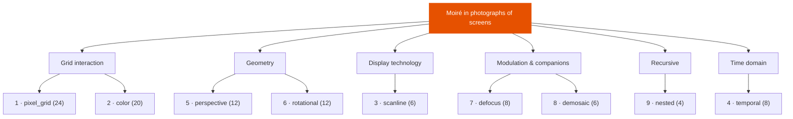

# Moiré effect types — taxonomy, causes, and prevalence weights

When a digital camera photographs a display, more than one interference
mechanism can be responsible for the visible artifacts. This document is the
project's canonical catalogue of the **nine moiré effect types**: for each
type it records the physical cause, the characteristic visual signature, the
prevalence **weight**, and the mapping onto the procedural synthesis
generators.

The possibility (sampling probability) of each type is defined as:

```text
possibility(type) = weight(type) / total_weight
```

with `total_weight = 100` over the full registry, so each weight also reads
directly as a percentage. The machine-readable registry lives in
`src/spatial_moire/moire_types.py` (`MOIRE_TYPES`); the referenced generators
live in `src/spatial_moire/synthesis/augment.py` (`MOIRE_GENERATORS`).

## Taxonomy



## Weights and possibilities

| # | Type | Registry key | Category | Weight | Possibility |
|---|------|--------------|----------|-------:|------------:|
| 1 | Pixel-grid moiré (screen-door / honeycomb) | `pixel_grid` | grid interaction | 24 | 0.24 |
| 2 | Color moiré (rainbow / false-color) | `color` | grid interaction | 20 | 0.20 |
| 3 | Scan-line moiré (CRT / interlaced) | `scanline` | display technology | 6 | 0.06 |
| 4 | Temporal moiré (flicker / rolling bands) | `temporal` | time domain | 8 | 0.08 |
| 5 | Perspective / keystone moiré (chirped) | `perspective` | geometry | 12 | 0.12 |
| 6 | Rotational moiré | `rotational` | geometry | 12 | 0.12 |
| 7 | Defocus-modulated moiré | `defocus` | modulation | 8 | 0.08 |
| 8 | Demosaic artifacts | `demosaic` | companion | 6 | 0.06 |
| 9 | Nested / recursive moiré | `nested` | recursive | 4 | 0.04 |
|   | **Total** | | | **100** | **1.00** |

The weights encode how often each type is the *dominant* observable mechanism
in real-world "photo of a screen" cases. Several types co-occur in practice
(color moiré usually brings demosaic artifacts along, and handheld shots
combine perspective with rotation); the weights deliberately model the
dominant-type distribution, not joint occurrence.

## 1. Pixel-grid moiré ("screen-door" / honeycomb moiré)

- **Cause:** screen pixel pitch (projected onto the sensor) ≈ sensor pixel
  pitch → beat frequency.
- **Looks like:** coarse wavy bands, worm-like or cellular blobs,
  honeycomb/diamond lattices, a faint "watermark" floating over the image.
  Usually low-frequency and large-scale — the fringes are much bigger than
  either grid.
- **Notes:** this is the one most people mean by "photo of a screen looks
  weird" and the reason screen photography is inherently moiré-prone; it is
  the highest-weighted type in the registry.
- **Weight / possibility:** 24 → 0.24 (24%).
- **Synthesis mapping:** `linear_beating` (two detuned near-Nyquist gratings
  beating into coarse bands), `screen_shoot` (display-grid vs camera-grid
  simulation with sub-pixel misalignment).

## 2. Color moiré (rainbow / false-color moiré)

- **Cause:** LCD subpixels are RGB stripes, and the camera's Bayer CFA
  samples R, G and B at different spatial positions. The stripe frequency
  aliases against the CFA.
- **Looks like:** magenta/green or cyan/red fringes, rainbow blotches,
  colored bands that shift as you move the camera. Distinctly chromatic —
  often visible even when luminance moiré is mild.
- **Notes:** PenTile (OLED phone) panels produce a different, coarser color
  pattern than RGB-stripe IPS panels.
- **Weight / possibility:** 20 → 0.20 (20%).
- **Synthesis mapping:** `chromatic_fringe` (per-channel sinusoids with
  channel phase/angle offsets), `screen_shoot` (RGB-subpixel display sampled
  by a misaligned Bayer-like camera grid).

## 3. Scan-line moiré (CRT / interlaced content)

- **Cause:** horizontal scanlines (or interlaced fields) beat against the
  camera sensor rows.
- **Looks like:** horizontal banding, thick "venetian blind" bars, sometimes
  slow vertical drift across the frame. On CRTs the bands curve because the
  screen is spherical.
- **Weight / possibility:** 6 → 0.06 (6%).
- **Synthesis mapping:** `scanline_bands` (near-horizontal detuned gratings
  beating into thick tilted bars).

## 4. Temporal moiré (flicker / rolling bands)

- **Cause:** refresh rate or PWM backlight dimming beats against the shutter
  speed / rolling shutter readout.
- **Looks like:** horizontal brightness bands that roll up or down the
  frame; on video, moving bars; on stills shot with a fast shutter, dark and
  light stripes. This is a *time-domain* beat, distinct from the spatial
  ones.
- **Weight / possibility:** 8 → 0.08 (8%).
- **Synthesis mapping:** `temporal_bands` (luminance-only horizontal banding
  — the single-frame footprint of a rolling temporal beat; see scope notes).

## 5. Perspective / keystone moiré ("chirped" moiré)

- **Cause:** shooting the screen at an oblique angle makes its projected
  spatial frequency vary across the frame (foreshortened at one edge,
  stretched at the other). Any wide-angle lens distortion does the same.
- **Looks like:** fringes that curve, bend and converge — contour-line-like
  arcs, hyperbolic shapes, patterns that compress toward one side. Very
  visually distinctive and the most "artistic" of the bunch.
- **Weight / possibility:** 12 → 0.12 (12%).
- **Synthesis mapping:** `zone_plate` (chirped concentric rings with optional
  swirl), `alias_warp` (near-Nyquist texture warped by nearest-neighbor
  resampling).

## 6. Rotational moiré

- **Cause:** the camera is rotated slightly relative to the screen's pixel
  axes (even 1–2 degrees).
- **Looks like:** rotated fringe sets; with lens distortion or perspective,
  curved or hyperbolic fringes instead of straight ones. Combined with #5,
  this gives the classic swirly "photo of a monitor" look.
- **Weight / possibility:** 12 → 0.12 (12%).
- **Synthesis mapping:** `linear_beating` (rotated carrier/detune angles),
  `screen_shoot` (explicit `camera_rotation_degrees` misalignment).

## 7. Defocus-modulated moiré

- **Cause:** slight blur acts as a low-pass filter on the screen grid before
  it hits the sensor.
- **Looks like:** moiré that appears, shifts, or vanishes while racking
  focus. Sometimes focusing slightly in front of or behind the screen gives
  a cleaner pattern than perfect focus.
- **Notes:** useful as a diagnostic — if the pattern changes with focus, it
  is sampling moiré, not content.
- **Weight / possibility:** 8 → 0.08 (8%).
- **Synthesis mapping:** `defocus_moire` (beat pattern plus strong pattern
  and image low-pass blur).

## 8. Demosaic artifacts (moiré's companions)

- **Cause:** the demosaic algorithm guesses color from an aliased Bayer
  pattern.
- **Looks like:** "zipper" or "maze" patterns, false color at edges,
  cross-hatching. Often rides along with #2 and is hard to separate
  visually.
- **Weight / possibility:** 6 → 0.06 (6%).
- **Synthesis mapping:** `alias_warp` (near-Nyquist colored grid warped by
  nearest-neighbor resampling — the closest synthetic stand-in for
  zipper/maze structure).

## 9. Nested / recursive moiré

- **Cause:** the screen is showing an image that itself has periodic
  structure (a photo of a screen, a striped shirt, a halftone print).
- **Looks like:** two moiré patterns superimposed — a coarse one from the
  screen grid, a finer one from the content. Rare but striking.
- **Weight / possibility:** 4 → 0.04 (4%).
- **Synthesis mapping:** `nested_moire` (two other generators applied in
  sequence, coarse + fine superimposed).

## How the weights are used

- `sample_moire_type(rng=...)` draws a type with possibility
  `weight / total_weight`; `type_probabilities()` exposes the exact numbers
  and `total_weight()` the current sum.
- `augmented_moire_dataset` (training augmentation in
  `src/spatial_moire/baseline/augmentation.py`) draws the moiré type this way
  for every augmented clean image, then runs one of the type's mapped
  generators (uniform pick among the mapped generators).
- `src/generate_moire_samples.py --sampling weighted` samples output types
  by the same distribution and records `type`, `generator`, and `probability`
  per entry in `moire_synthesis_params.json`; the default `--sampling grid`
  mode still renders one sample per selected type per source image so the
  full preview grid is available.
- `src/train_baseline.py --moire-augment-types ...` restricts training
  augmentation to a subset of types.
- Passing a subset of types (CLI `--types ...` / `type_names=[...]`)
  renormalizes the weights over the selection only, e.g. restricting to
  `pixel_grid` and `color` gives possibilities 24/44 ≈ 0.545 and 20/44 ≈ 0.455.

## Tuning the weights

1. Edit the `weight=` values in `MOIRE_TYPES` in
   `src/spatial_moire/moire_types.py`.
2. Possibilities recompute automatically as `weight / total_weight`; the sum
   is validated to stay 1.0 (any total works, not just 100).
3. Update the pinned expectations in `tests/test_moire_types.py`
   (`EXPECTED_WEIGHTS`) and the table above so documentation, registry, and
   tests stay in sync.

## Scope notes

- **Temporal moiré is a time-domain beat**, not a spatial one: it needs the
  refresh-rate/PWM vs shutter interplay over time. This project targets
  still images, so the registry approximates its *single-frame appearance*
  (horizontal brightness bands) via the `temporal_bands` generator and keeps
  its weight moderate (8). If only spatial types are wanted, restrict
  sampling to the other eight types via `--types`/`type_names`.
- **Defocus-modulated moiré and demosaic artifacts are companions or
  modulations rather than independent beat mechanisms**, but they are
  weighted as distinct types because they produce distinct, separately
  observable visual evidence.
- The README's earlier statement that temporal moiré is out of scope is
  superseded by this registry: the temporal *appearance* is now part of the
  catalogue, while temporal *dynamics* (rolling video bands) remain out of
  scope for the still-image detection pipeline.